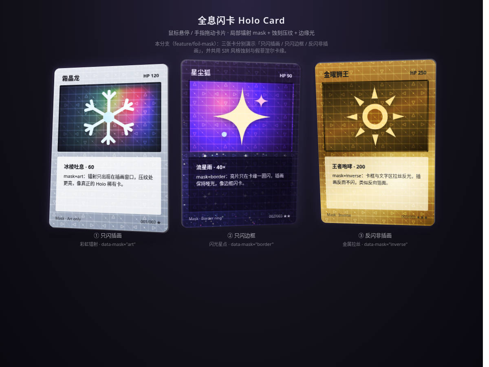

# Holo Card 全息闪卡 · feature/foil-mask

零依赖的网页全息闪卡特效。本分支在 main 的彩虹 / 星点 / 金属三种箔面之上，增加了 **局部镭射 mask**、**蚀刻压纹** 与 **边缘光（假菲涅尔 + 纸张厚度）**。

**在线预览：** 需将 GitHub Pages 切到本分支，或本地打开 `index.html`。仓库主预览仍指向 main：https://mattamior.github.io/holo-card/

## 本分支新增

### 1. 局部镭射 mask（`data-mask`）
灰度 mask 控制「哪里有箔、强度多少」，全部用内联 SVG / CSS 程序化生成，无外部版权图。

| 卡片 | `data-mask` | 效果 |
|------|-------------|------|
| ① 霜晶龙 | `art` | **只闪插画**：关掉卡框箔，镭射仅出现在插画窗口 |
| ② 星尘狐 | `border` | **只闪边框**：环形 SVG mask，亮片只在卡缘一圈 |
| ③ 金曜狮王 | `inverse` | **反闪非插画**：仅卡框箔；插画不透明底挡住，文字区半透可见箔光 |

切换方式：改卡片根节点的 `data-mask="art|border|inverse"` 即可。

### 2. 蚀刻压纹（SIR 感）
`--mask-etch` 是细线 + 几何点的灰度纹理：
- 作为箔层的额外 `mask`（与指针 mask 取交集）→ **压纹处更亮**
- `.card__etch` 浮雕叠层（`mix-blend-mode: overlay`）→ 静止也能看出蚀刻

可调：`--etch-size`（密度）、`--etch-boost`（悬停强度）、`--etch-idle`（静止可见度）。

### 3. 边缘光 + 纸张厚度
- `.card__rim`：inset 描边 + 随 `--tilt` 变亮的假菲涅尔（倾斜越大卡缘越亮）
- `box-shadow` 侧面：随 `--rx/--ry` 偏移的极薄暗边 / 亮边，模拟纸张厚度

可调：`--rim-idle`、`--rim-max`、`--thickness`。

## 与 main 相同的基础能力
鼠标悬停或手指拖动时 3D 倾斜，高光与镭射随指针流动，移开后弹簧回正；尊重 `prefers-reduced-motion`。

## 调参速查
| 位置 | 变量 | 含义 |
|------|------|------|
| `:root` | `--etch-size` / `--etch-boost` / `--etch-idle` | 蚀刻密度与明暗 |
| `:root` | `--rim-idle` / `--rim-max` / `--thickness` | 边缘光与厚度 |
| `:root` | `--mask-etch` / `--mask-border` | 替换为自定义 SVG mask |
| 卡片 | `data-mask` / `data-effect` | mask 变体 × 箔面风格 |
| 脚本 `CONFIG` | `maxTilt`、弹簧 `stiffness/damping` | 倾斜角与手感 |

## 使用
用浏览器直接打开 `index.html`。截图见 `screenshots/foil-mask-idle.png`（静止）与 `foil-mask-hover.png`（悬停）。

## 致谢
思路参考 [simeydotme/pokemon-cards-css](https://github.com/simeydotme/pokemon-cards-css)。卡面与 mask / 蚀刻均为 CSS 与内联 SVG 绘制，无外部图片素材。
