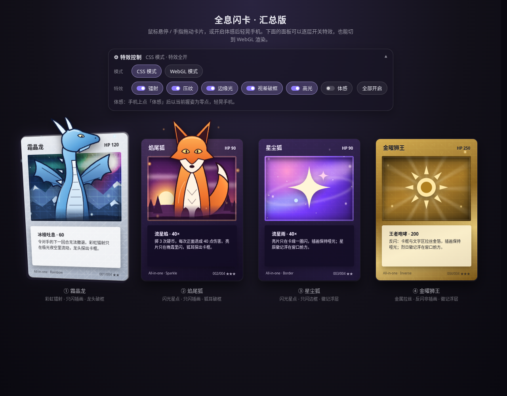
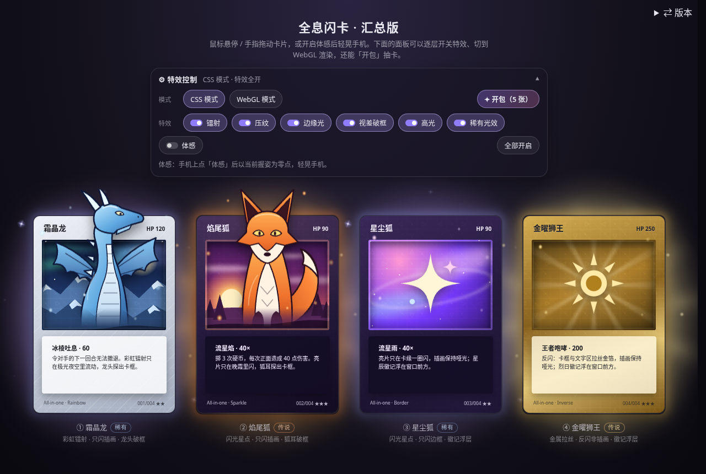
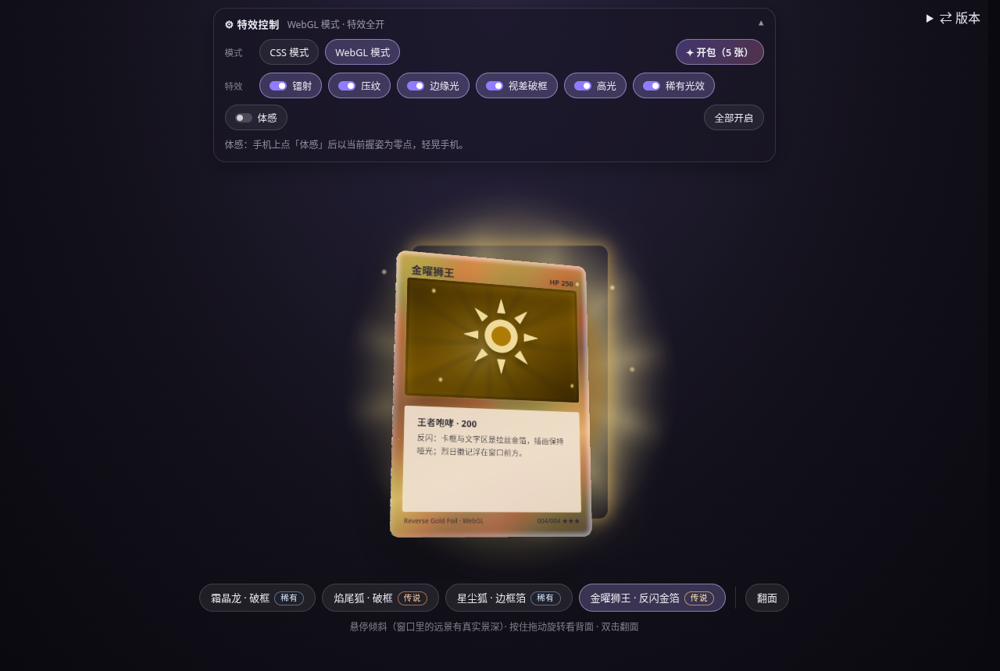
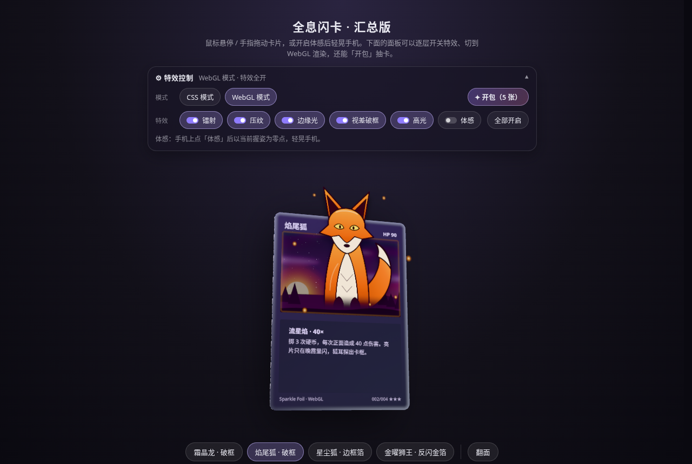
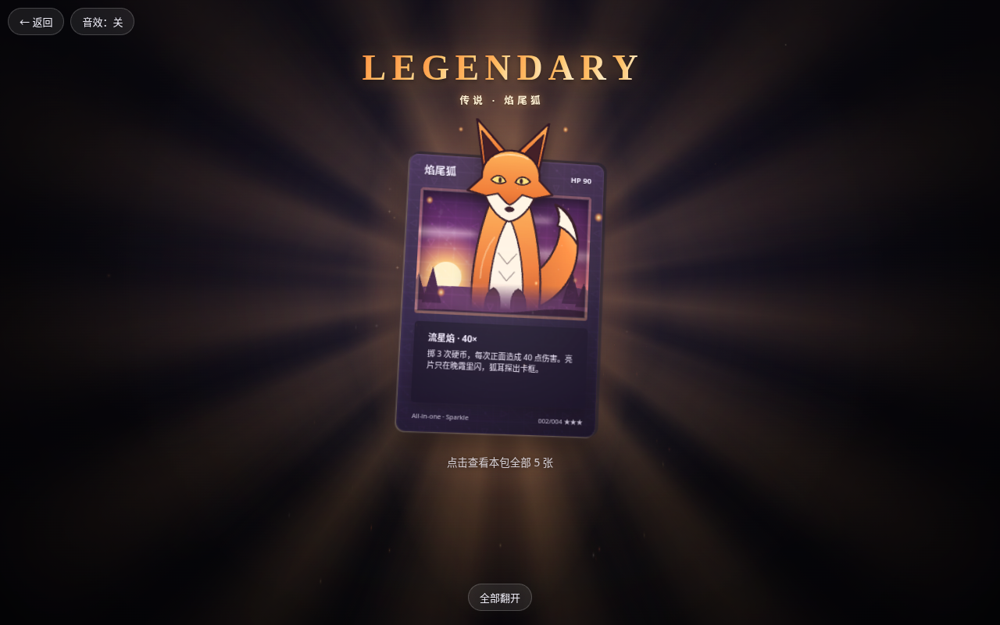
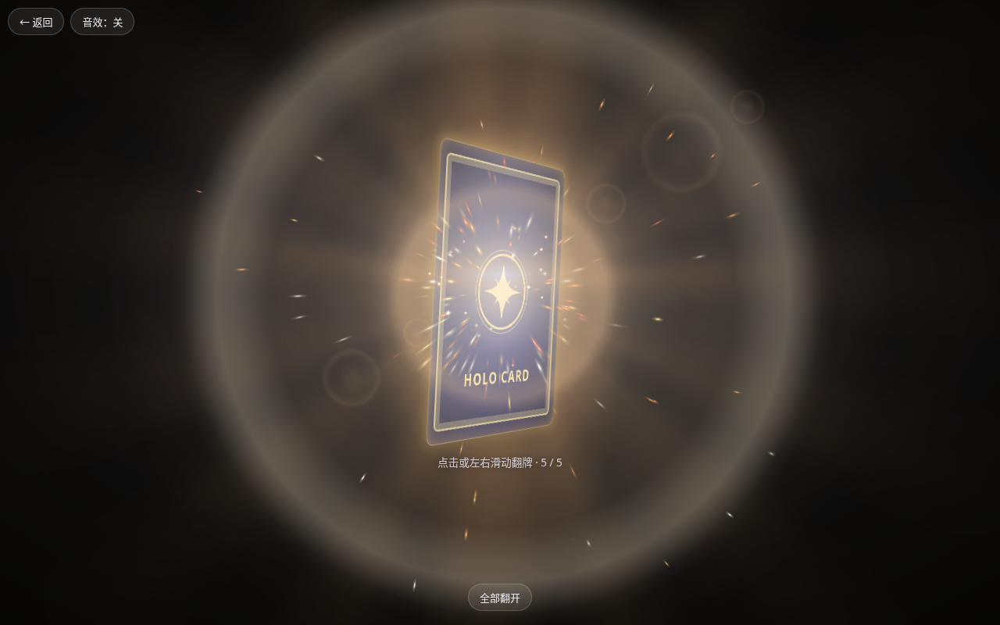
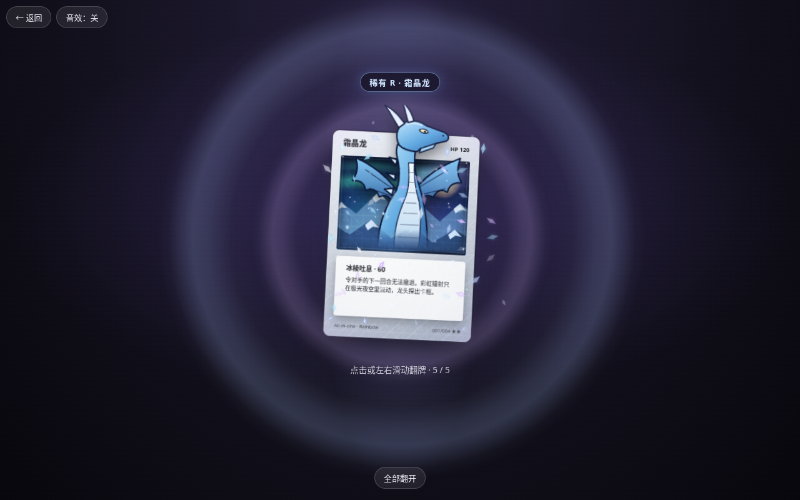
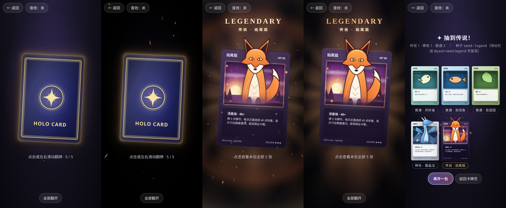

# Holo Card 全息闪卡

零依赖的网页全息闪卡特效：鼠标悬停或手指拖动时卡片 3D 倾斜，高光与镭射随指针流动，移开后平滑回正。

**在线预览（版本总览）：** https://mattamior.github.io/holo-card/ · **本分支：** https://mattamior.github.io/holo-card/all-in-one/

> **当前分支：`feature/all-in-one`** —— 汇总版：把其他分支的全部特效合到一个页面里，带中文特效控制面板，并可一键切到 WebGL 渲染（四张卡都是真 3D 多层视差 + 角色破框），还能「开包」抽卡。基于 `main` 切出，其他分支未改动。

## feature/all-in-one：汇总版（全部特效）

一页里四张卡，每张都同时叠加：**箔面**（彩虹镭射 / 闪光星点 / 金属拉丝三选一）+ **局部 mask** + **蚀刻压纹** + **边缘光与纸张厚度** + **多层视差**（两张角色破框）+ **鼠标 / 触摸倾斜** + **陀螺仪体感**。

| 卡 | 稀有度 | 箔面 | 局部 mask | 视差 |
|---|---|---|---|---|
| ① 霜晶龙 | 稀有 R | 彩虹镭射 | 只闪插画（极光夜空） | 龙头破框 |
| ② 焰尾狐 | 传说 UR | 闪光星点 | 只闪插画（晚霞） | 狐耳破框 |
| ③ 星尘狐 | 稀有 R | 闪光星点 | 只闪边框（羽化环形遮罩） | 星辰徽记浮在窗口前 |
| ④ 金曜狮王 | 传说 UR | 金属拉丝 | 反闪（卡框 + 文字区，插画哑光） | 烈日徽记浮在窗口前 |

**整合方式**（手工整合，不是 merge）
- 以 `feature/parallax` 的 3D 结构为骨架：`.card__rotator` 是唯一的 `preserve-3d` 容器，投影 / 纸张厚度 / 卡框 / 文字 / 角色 / 粒子都是它的直接子平面。
- `feature/foil-mask` 的箔层、蚀刻、高光、边缘光全部放进**卡框层平面内部**混合（mask / blend / filter 只压平卡框层自己，不影响层间景深）；文字层浮在所有光层之上，所以文字永远清晰。纸张厚度移到卡片背后单独一层。
- `feature/gyro` 的体感逻辑改成同时服务两种模式：CSS 模式驱动视口里的卡，WebGL 模式驱动 3D 卡（指针优先，松手后回到体感姿态）。
- `feature/webgl` 的 `js/holo.js`、`js/textures.js`、`vendor/three-holo.min.js` 带过来（three 子集未重新打包），`holo.js` 加了嵌入模式：画布按自身尺寸渲染、透明背景、`setActive` / `setGyro` / `setEffects` 接口，并扩展成四张卡的多层结构（见下）。

**特效控制面板**（标题下方，跟着页面排版，不浮在卡片上；手机上默认收起成一行摘要）
- 模式：CSS 模式 / WebGL 模式。WebGL 只在第一次切过去时才下载 three（gzip 约 147 KB）；没有 WebGL2 时弹出提示并留在 CSS 模式。地址加 `#webgl` 可直接打开 WebGL 模式。
- 开关：镭射、压纹、边缘光（含纸张厚度）、视差破框（关掉后各层贴回卡面、角色收回窗口）、高光、稀有光效（见下）、体感。WebGL 模式下同样生效（镭射 = 箔面 / 亮片 / 薄膜干涉，压纹 = 法线贴图，边缘光 = 菲涅尔卡缘，高光 = 覆膜反光 + Bloom）；视差破框在 WebGL 模式下同样可用（见下）。
- 开关状态记在 `localStorage`，「全部开启」一键恢复。体感需要用户点按钮授权，不记忆。

### 稀有光效（卡片页常驻，面板「稀有光效」开关，默认开）

平常浏览卡片时也能看到稀有度（和开包里一致：霜晶龙、星尘狐 = 稀有；焰尾狐、金曜狮王 = 传说），复用开包结果页的常驻氛围，不含爆发类特效：

| | 稀有 R | 传说 UR |
|---|---|---|
| 光晕 | 蓝紫柔光，4.2 s 慢呼吸 | 主题色（焰尾狐火焰橙、金曜狮王太阳金），3.2 s 呼吸 |
| 点缀 | 6 颗星形 / 水晶微光在卡框四周轮流闪 | 一圈很淡的慢转光芒（48 s 一圈）+ 8 粒缓缓下落的光尘 |
| 徽章 | 卡下方标签、WebGL 卡面选择按钮旁的「稀有」小徽章 | 「传说」小徽章 |

- **不压平 3D、不盖文字**：光效节点 `.aura` 是 `.card` 的兄弟节点（在 `.card__rotator` 之外），`z-index:-1` 垫在所有卡片后面；卡面上不加任何东西。
- **跟随倾斜**：卡片弹簧每帧顺便写 `--ax / --ay / --ao`，光晕朝翘起的另一侧偏移（每度 1 px，最多约 14 px），悬停时叠一层增强光（只改 opacity）。
- **WebGL 模式**：画布是透明的，光效层放在画布**后面**的 DOM 里；`holo.js` 新增 `onLayout`（卡片静止矩形）和 `onFrame`（倾斜姿态）两个回调用来对齐和跟随，切卡时换成对应稀有度 / 主题色。
- **无硬边**：光晕是多段色标一路降到 0 的椭圆径向渐变 + 一块整体高斯模糊的实心圆角矩形（贴着卡缘的那圈光；实心而不是空心阴影，倾斜错位时也不会露出暗矩形）；光芒截面近似正弦、两端径向淡出；节点自身 `overflow:hidden` 时裁切处已经完全透明；卡片区左右铺满到视口再 `overflow-x: clip`，不会出现横向滚动条。
- **性能**：全部是 CSS 动画、只动 transform / opacity，没有 JS 循环；实测（Chromium 跟踪）开着时 3 秒内**零次重绘**，全在合成器上跑。卡片滚出视口（提前 120 px）时光效节点 `display:none`，合成层一起释放；开包覆盖层打开时暂停；手机上粒子减到 5 个。关掉开关时节点直接移除，`document.getAnimations()` 里不剩任何光效动画。
- **减少动态效果**：只保留静态光晕，不呼吸、不转、不落尘、不偏移。
- 开包覆盖层打开时同时隐藏部署注入的「⇄ 版本」按钮（`html.pk-open #hcv-nav { display:none }`），关闭后恢复。

**克制与无硬边**
- 叠加后整体再收一档：彩虹最大不透明度 0.75、高光 0.45、蚀刻 0.12→0.42、边缘光 0.1→0.5。
- 边框环遮罩改成透明底 + 高斯羽化的 SVG 环（mask 按 alpha 取值，旧写法的黑色底其实不起遮罩作用），环的内沿在文字面板和插画窗口外就衰减完，箔光不会被面板直边截断。
- 自查方法同前：同一姿态下开 / 关光层（镭射、高光、边缘光）做差值图，排除关光图里本来就有的几何边缘后找长直线；Chromium / Firefox / WebKit × 4 张卡 × 9 个姿态。剩下的命中都在卡片轮廓上（边缘光本来就沿卡缘），或是文字面板挡住卡框光的位置，幅度很小。

**性能**
- 每张卡各自一个弹簧循环，只在弹簧还在动时运行：静止时没有任何卡在写样式，悬停时只有当前那张在更新。
- 卡片滚出视口时粒子动画暂停，体感也只驱动视口里的卡；切到 WebGL 时 CSS 卡片整个隐藏，切回 CSS 时 WebGL 停止渲染；WebGL 画布滚出视口或页面隐藏时同样停止。
- 尊重 `prefers-reduced-motion`：不倾斜、粒子不动、体感不可用，只保留光泽变化。

### WebGL 模式：多层视差 + 破框

- 四张卡（霜晶龙、焰尾狐、星尘狐、金曜狮王）全部用 WebGL 渲染，和 CSS 模式一一对应。
- **插画窗口用模板缓冲（stencil）开洞**：卡面写 1，窗口遮罩写 2；远景、中景两个平面放在卡面**后方**（z = −0.55 / −0.25），只在 stencil = 2 的地方画，所以倾斜时能透过窗口看到真实的纵深位移，背面看不到任何漏光。
- **角色是浮在卡面前方的独立平面**（z = +0.32），透明 + 羽化边缘，头 / 耳朵超出卡框顶部；粒子层更靠前（z = +0.6）。各层按相机距离做缩放补偿（和 CSS 的 translateZ + scale 同一套算法），正面看时与平面构图完全重合。
- **箔面只作用在该闪的层**：霜晶龙的彩虹镭射在远景天空层、焰尾狐的亮片在晚霞层；角色、文字面板不闪。星尘狐只闪边框，金曜狮王是卡框 + 文字区反闪。
- 角色、远景、中景贴图都是把页面里现成的 SVG 光栅化到 canvas（没有新增图片资源），边缘用 smoothstep 渐变羽化，角色底部渐隐融进窗口。
- 「视差破框」开关在 WebGL 下可用：关掉后各层压回卡面（深度 ×0.02），角色用 stencil 裁回窗口内。
- 体感、拖动旋转、翻面、性能策略（静止停渲染、滚出视口停渲染）都保留；贴图按卡懒加载，切卡时才光栅化。

### 开包（抽卡动画）

控制面板上的「✦ 开包（5 张）」按钮，CSS / WebGL 两种模式都能用；全屏覆盖层，结束后回到卡牌页（Esc 或「返回」随时退出）。

**怎么玩**
1. **撕包**：手指 / 鼠标沿卡包顶部的光点虚线从一侧划到另一侧（划过 ≥ 70% 宽度），会留下发光轨迹，包头沿锯齿撕口裂成两半飞走。不方便拖动时点「撕开卡包」按钮（键盘 Enter / 空格同样可以）。
2. **出卡**：5 张卡从包里滑出叠成一摞。
3. **翻牌**：点击或左右滑动翻开最上面一张（← → / Enter 也可以），再点一下让它飞走看下一张；「全部翻开」直接跳到结果页。高级卡在翻开前会有预兆（见下）；传说演出进行中再点一下可以直接跳到展示状态。
4. **结果页**：5 张卡一览，点任一张放大，用原有的倾斜 / 体感交互（WebGL 模式下稀有 / 传说卡用 WebGL 卡放大，普通卡用 CSS 卡）。「再开一包」/「返回卡牌页」。

**稀有度与概率**

| 稀有度 | 卡池 | 第 1–4 张 | 第 5 张（保底位） | 演出 |
|---|---|---|---|---|
| 普通 C | 6 张简化卡（苔团团、泡泡鱼、石壳虫、风铃雀、菇菇灯、萤尾虫），无箔面 | 78% | — | 普通翻面 |
| 稀有 R | 霜晶龙、星尘狐 | 18% | 80% | 蓝紫预兆光 → 光柱 + 冲击波光环 + 水晶光片 → 卡面扫光 |
| 传说 UR | 焰尾狐、金曜狮王 | 4% | 20% | 金色预兆 → 蓄力 → 爆发 → 放大展示 → LEGENDARY 字样（分镜见下） |

每包至少 1 张稀有；每包出传说的概率约 32%。同一包内不重复，某档抽空时降一档。翻牌顺序按稀有度从低到高，传说永远压轴。

**高级卡演出**（普通卡保持朴素的一次翻面，形成反差；翻牌节奏沿用 `FLIP_SLOW = 2.2`）

| 阶段 | 稀有 R（约 2.0 s） | 传说 UR（约 4.0 s，点击可跳过） |
|---|---|---|
| 翻牌前预兆 | 卡背渗出蓝紫边缘光，光晕缓慢呼吸 | 卡背渗出金色边缘光，间歇轻颤，周围有光粒被慢慢吸入 |
| 蓄力 | — | 0–1.5 s：画面压暗，吸入光粒越来越密、越来越快；卡片颤动渐强；低频音效上扬，震动由疏到密 |
| 爆发 | 翻到侧面那一刻：两圈柔边冲击波 + 水晶光片 + 四芒星闪光 | 1.5 s：短暂柔和闪白（暖色、峰值约 0.6，不是纯白）、三层冲击波、两层反向旋转的放射光芒、双色拖尾粒子（带重力）、光晕 + 镜头光斑 |
| 揭晓 | 落定后一道柔光扫过卡面，显示「稀有 R」标签 | 1.5–2.5 s：边翻面边放大到 1.3 倍并带一点 Z 向旋转，随后用 1.1 s 慢慢回落到 1.08 倍 |
| 字样 | — | 约 2.65 s：金色「LEGENDARY / 传说 · 卡名」逐字带模糊入场，之后一道流光循环扫过 |
| 展示 | — | 背景光芒慢转、金色光尘飘落、卡片小幅摇摆展示镭射，直到点击收下 |

- 两张传说卡用各自的主题色：焰尾狐是火焰橙，金曜狮王是太阳金（光芒、粒子、冲击波、字样渐变都跟着变）。
- 音效（仍默认关闭）：蓄力低频上扬、爆发低频冲击 + 和弦、字样入场的上行铃音、稀有冲击波的气声。支持的设备上，震动跟着蓄力节奏由疏到密，爆发时一次长震。
- 结果页里稀有 / 传说卡有常驻的柔和光晕和几颗慢慢闪的微光（纯 CSS）。
- `prefers-reduced-motion`：只保留淡入和静态光晕（传说卡仍显示字样，但不逐字入场），没有震动、闪白、粒子爆发、旋转光芒和摇摆。

**可调参数**（`js/pack.js`）
- `FLIP_SLOW`：翻牌速度倍率（越大越慢，当前 2.2）。
- `LEGEND`：传说分镜时间，`charge` 蓄力时长、`flip1` / `flip2` 翻面两段（会再乘 `FLIP_SLOW`）、`settle` 回落时长、`titleAt` 字样入场时刻（毫秒）。
- `THEME`：各演出的主题色（放射光、光晕、粒子、冲击波、字样渐变三段色）。
- 粒子数：`createFx` 里的 `base`（按屏幕面积开方缩放，360×740 约 0.5，DPR ≥ 3 再打 8 折）× `adapt`（运行中帧时间持续超过 24 ms 时逐步降到最低 0.4），同时在场粒子上限 `700 × base`。

**测试种子**（地址栏加 `#pack=…`，WebGL 模式写成 `#webgl&pack=…`）
- `seed-legend`：必出传说焰尾狐（3 普通 + 霜晶龙 + 焰尾狐）
- `seed-legend-lion`：必出传说金曜狮王
- `seed-rare`：4 普通 + 1 稀有
- `seed-common`：5 张普通
- `seed-all`：1 普通 + 2 稀有 + 2 传说
- 其他任意字符串：按概率抽，但同一种子结果固定，可复现。

**实现**
- 卡包是程序化绘制的（CSS 渐变 + 箔面 + 锯齿压边），无版权素材；跟随指针轻微倾斜、箔光流动。
- 撕包：两半各用 `clip-path` 裁出，共享同一条锯齿撕口折线；动画用 WAAPI，没有引入 GSAP。
- 粒子 / 撕包轨迹 / 冲击波 / 镜头光斑：Canvas 2D，全部是预渲染的柔边精灵（径向渐变或逐像素 smoothstep 生成的光点、水晶片、四芒星、空心光环），`lighter` 叠加；只在有东西要画时跑 rAF，演出结束后剩余粒子 0.6 s 内淡出、循环停止；页面隐藏时浏览器自动暂停。本包有高级卡时，演出用的精灵会在空闲时提前生成，翻牌瞬间不卡顿。
- **无硬边**：光柱是椭圆径向渐变，放射光芒是平滑正弦轮廓的 conic 渐变再乘径向遮罩，冲击波是内外两侧都有长渐变的空心光环，扫光是多段色标的宽光带，镜头光斑做成胖椭圆（不会变成一条细亮线），闪白是带暗角的径向渐变。自查时对关键帧在卡片和按钮以外的区域找亮度突变的像素，只剩零星粒子。覆盖层打开时会去掉页面预留的滚动条槽，否则亮场景时右侧会露出一条直边。
- **音效**：WebAudio 程序化合成（无音频文件），默认关闭，覆盖层左上角「音效」开关切换并记忆。
- 卡片克隆时 SVG 的 id 全部改成唯一值，避免和页面里的卡冲突。

**取舍与已知问题**
- WebGL 下的粒子是静态光点（CSS 版会闪烁漂浮）。
- 普通卡只有 CSS 简化版，WebGL 模式放大普通卡时也用 CSS 卡。
- 角色是平面「立牌」：倾斜角度本身有上限（和 CSS 版一致），在这个范围内看不出薄片感，但它确实是一张平面，不是 3D 模型。
- 第一次切到 WebGL 时要光栅化 SVG 贴图，低端手机上切卡会有不到半秒的加载。
- 开包里的 3D 翻面用「两段 90° + 中途换面」实现，不依赖 `backface-visibility`（各浏览器表现更一致）。
- 开包演出在 CSS / WebGL 两种模式下是同一套（覆盖层里的卡都是 CSS 卡），WebGL 模式只在结果页放大稀有 / 传说卡时用 WebGL。
- 传说展示状态下卡片的摇摆每帧写 CSS 变量（和悬停同一套），低端机上这一段比静止时费电；收下后立即停止。
- 帧率自适应只会降不会升：同一包里前面掉过帧，后面的演出会一直用较少的粒子。

**本地预览**：WebGL 模式用的是 ES 模块，需要静态服务器（例如 `python3 -m http.server` 后打开 http://localhost:8000/ ）；CSS 模式直接双击 `index.html` 也能用。

**自查截图**：`screenshots/all-in-one-*.png`（桌面三引擎、各角悬停、开关对比、体感、WebGL、WebGL 破框倾斜、360px 手机、无 WebGL2 降级；开包：撕包中 `pack-tearing`、堆叠 `pack-stack`、传说爆发 `pack-legend-burst`、传说展示 `pack-legend-show`、稀有 `pack-rare`、结果页 `pack-result`、手机 `pack-mobile-360`）。

---

以下是各分支通用的说明。

## 多版本在线预览
每个升级版本都保留为一个独立分支，部署后对应线上一个路径。各版本页右上角有「⇄ 版本」悬浮按钮，可以随时切换（手机上收成一个小圆钮）。

| 路径 | 版本 | 分支 |
|---|---|---|
| [`/`](https://mattamior.github.io/holo-card/) | 版本总览首页 | 由 `main` 上的构建脚本生成 |
| [`/classic/`](https://mattamior.github.io/holo-card/classic/) | 经典 CSS 版（本分支） | [`main`](https://github.com/mattamior/holo-card/tree/main) |
| [`/gyro/`](https://mattamior.github.io/holo-card/gyro/) | 陀螺仪体感 | [`feature/gyro`](https://github.com/mattamior/holo-card/tree/feature/gyro) |
| [`/foil-mask/`](https://mattamior.github.io/holo-card/foil-mask/) | 局部镭射 + 蚀刻压纹 | [`feature/foil-mask`](https://github.com/mattamior/holo-card/tree/feature/foil-mask) |
| [`/parallax/`](https://mattamior.github.io/holo-card/parallax/) | 多层视差 · 角色破框 | [`feature/parallax`](https://github.com/mattamior/holo-card/tree/feature/parallax) |
| [`/webgl/`](https://mattamior.github.io/holo-card/webgl/) | WebGL 旗舰版 | [`feature/webgl`](https://github.com/mattamior/holo-card/tree/feature/webgl) |

### 自动部署
Pages 的发布来源是 GitHub Actions（workflow：[`.github/workflows/pages.yml`](.github/workflows/pages.yml)）。

- **改 `main`**：push 后直接在 `main` 上构建并部署。
- **改任意 `feature/*` 分支**：push 后，该分支上的同一份 workflow 会在 `main` 上触发一次部署（`workflow_dispatch`），由 `main` 统一组装。所以每个 feature 分支上也都放了这份 workflow 文件（只有这一个文件，效果代码没动）；从 `main` 或现有 feature 分支切出的新分支会自动带上它。
- **新增分支**：推送一个新的 `feature/<名字>` 分支（根目录有 `index.html`），下次部署会自动出现在 `/<名字>/` 和首页上；想要自定义标题、说明和缩略图，在 [`.github/pages/versions.json`](.github/pages/versions.json) 里登记。
- **手动重新部署**：Actions 页面选「Pages 多版本预览站」→ Run workflow（分支选 `main`），或 `gh workflow run pages.yml --ref main`。

组装脚本 [`.github/pages/build.mjs`](.github/pages/build.mjs) 用 `git archive` 导出每个分支的静态文件（不拷 `.github/`、`qa/`、`node_modules` 等），生成首页，并在部署时给每个版本页注入版本切换导航。分支源码本身不会被修改。本地预览整站：`node .github/pages/build.mjs _site`，然后用任意静态服务器打开 `_site`。

## 三种效果
1. **彩虹镭射**：彩虹条纹 + 扫描线，只出现在插画窗口，四边羽化。
2. **闪光星点**：柔边亮片与四芒星，只在指针附近闪烁。
3. **金属拉丝**：纯 CSS 拉丝纹理 + 随指针滑动的金色反光带。

## 原理
指针位置经弹簧缓动后写入 CSS 变量，CSS 用这些变量驱动 `rotateX/Y` 倾斜、`radial-gradient` 高光，以及 `repeating-linear-gradient` + `color-dodge` 混合的镭射层。支持触摸（Pointer Events），并尊重 `prefers-reduced-motion`。

## 使用
直接用浏览器打开 `index.html` 即可。尺寸、透视、色板、光泽强度等都是文件开头的 CSS 变量；倾斜角度与弹簧手感在脚本的 `CONFIG` 里调整。

## 致谢
思路参考 [simeydotme/pokemon-cards-css](https://github.com/simeydotme/pokemon-cards-css)。卡面均为 CSS 与内联 SVG 绘制，无外部图片素材。
