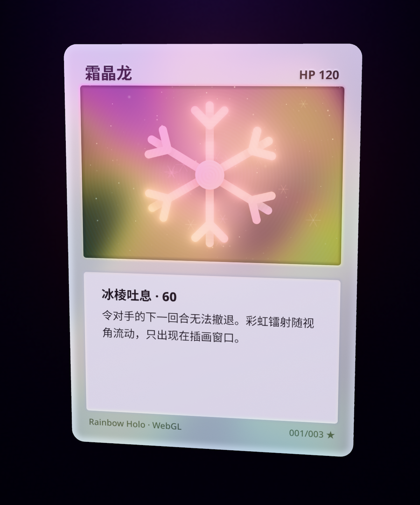

# Holo Card 全息闪卡

零依赖的网页全息闪卡特效：鼠标悬停或手指拖动时卡片 3D 倾斜，高光与镭射随指针流动，移开后平滑回正。

**在线预览：** https://mattamior.github.io/holo-card/

> **当前分支：`feature/webgl`** —— WebGL 旗舰版（Three.js 物理材质 + 自定义着色器 + Bloom）。基于 main 切出，CSS 主版 / 陀螺仪 / 局部箔面 / 视差在其他分支。

## feature/webgl：WebGL 旗舰版

把卡片当成一个真实的物体来渲染：有厚度的圆角薄片，覆膜、金属箔、薄膜干涉和亮片都由视角驱动，而不是在图片上叠一层跟着鼠标走的彩虹。

**文件结构**（纯静态、无构建步骤、全部相对路径，放在 GitHub Pages 子路径 `/webgl/` 下直接可用）
| 文件 | 内容 |
|---|---|
| `index.html` | 入口：页面 UI、importmap、WebGL2 检测与降级提示 |
| `js/holo.js` | 场景、材质与着色器注入、后处理、交互与按需渲染 |
| `js/textures.js` | canvas 程序化绘制卡面 / 卡背，逐像素生成法线贴图与箔面遮罩 |
| `vendor/three-holo.min.js` | three.js r186 摇树精简版（MIT），见 `vendor/README.md` |

**做法**
1. **卡片几何**：正面、背面各一块圆角 `ShapeGeometry`，侧边用 `ExtrudeGeometry`（只取侧壁），厚度 0.03（约 0.75mm）。侧边用顶点色做出“白纸 / 黑芯 / 白纸”三层，颜色是平滑过渡的。
2. **材质**：`MeshPhysicalMaterial`，开 `clearcoat`（覆膜）、`iridescence`（薄膜干涉，`iridescenceMap` / `iridescenceThicknessMap` 用箔面遮罩控制哪里有、膜多厚）、`normalMap`（卡框压纹、插画窗口内凹、标题凸印、蚀刻纹），金卡再开 `anisotropy` 做拉丝。
3. **`onBeforeCompile` 注入**（参考 Ziggy Card 的结构、Cyanilux 的切线空间视线采样思路，代码自行编写）：
   - **视角彩虹**：把相机位置变换到卡片局部（= 切线）空间，取视线斜率 `V.xy / V.z` 驱动余弦色板的相位，再叠一条随视角移动的光带；卡片一倾斜，彩虹就流动。
   - **箔面遮罩**：同一张遮罩同时改 `metalness`、`roughness` 和颜色（油墨印在箔上：暗部保留油墨色，亮部透出箔色）。
   - **程序化亮片**：卡面切成格子，每格一颗随机法线的亮片；只有亮片法线对准“视线 + 虚拟光”的半程向量时才亮，所以是转到某个角度“闪一下”。亮度还随旋转角速度略增。
   - **菲涅尔边缘光**：卡缘一圈随倾斜角增强的冷色光（正面按圆角矩形 SDF 平滑衰减，侧边按法线与视线夹角）。
4. **环境光**：PMREM 程序化生成。默认是自写的“柔光棚”（内表面着色的大球，全部是高斯光斑和柔光条）；也可以切回 three 自带的 `RoomEnvironment`（`CONFIG.env = 'room'`），但它的方形灯箱会在覆膜上映出直边，所以默认不用。
5. **后处理**：`RenderPass`（4×MSAA、半浮点）→ `UnrealBloomPass`（高阈值，只让亮片和箔面最亮处溢出）→ `OutputPass`（Neutral 色调映射，几乎不改卡面颜色）。
6. **卡面**：三张卡沿用 CSS 版的配色和图案（同样的 SVG 路径，用 `Path2D` 画进 canvas），外加共用的卡背。无外部图片。
   - 霜晶龙：插画窗口全箔 + 彩虹镭射 + 同心水波蚀刻，银色卡框带少量箔
   - 星尘狐：卡框和插画是亮片箔，深色底上亮片按角度闪
   - 金曜狮王：反闪，卡框与文字区是拉丝金箔，插画哑光
7. **交互**：悬停倾斜 + 弹簧回正，参数与 CSS 主版完全一致（最大 14°，跟手 260/30，回正 140/22）。按住拖动可整张旋转，松手按速度吸附到正面或背面；双击（触屏双击）或“翻面”按钮翻面。地址栏 `#frost` / `#star` / `#sun` 可直接打开某张卡。
8. **降级与性能**：
   - 没有 WebGL2：直接显示提示和返回 CSS 版的链接（`../`），不会下载 Three.js；WebGL 上下文丢失、importmap 不支持时同样提示。
   - `prefers-reduced-motion`：卡片不倾斜、不动画，只让彩虹相位和亮片角度随指针变化；翻面直接切换。
   - DPR 上限 2；按需渲染：弹簧静止后不再请求下一帧，页面隐藏时停止。

**无硬边 / 无接缝的处理**（这一版重点自查过）
- 所有遮罩都是带羽化的 SDF 解析计算，不是硬边位图；彩虹、薄膜厚度用正弦域扭曲的平滑场，**不用格点噪声**（格点值噪声的平台会在薄膜干涉里变成方块色斑和直边）。
- 平面卡面的法线、切线直接写解析值（`computeTangents` 在耳切法产生的细长三角形上会算错，法线贴图会沿三角形边出现直线）。
- 亮片完全落在自己的格子里，格子边界处恒为 0，没有拼接线。
- 投影平面放在卡片任何姿态都碰不到的深度（之前放得太近，旋转超过 30° 时会和卡面相交出一条竖线）。
- 默认环境里没有方形灯箱；8 位渐变全部加了轻微抖动，避免色带。
- 生成贴图的 canvas 用 `willReadFrequently`（CPU 画布），个别 GPU 画布实现会丢失大面积渐变。

**可调参数**
- `js/holo.js` 顶部 `CONFIG`：倾斜角与弹簧、拖动灵敏度、卡片尺寸 / 厚度 / 圆角、DPR 上限、视场、卡片占屏比例、曝光、环境类型与强度、Bloom（strength / radius / threshold）、边缘光颜色、亮片虚拟光方向。
- `CARD_LOOK`（每张卡一组）：`rainbow` 彩虹量、`holoEmit` 镭射流光亮度、`foilTint` 箔色、`foilMetal` / `foilRough` 箔区金属度 / 粗糙度、`foilCover` 箔色透出程度、`sparkle` / `sparkleDensity` 亮片亮度 / 密度、`bandFreq` / `viewFreq` 彩虹条纹密度 / 随视角变化速度、`iridescence` / `iriRange` 薄膜强度 / 膜厚范围（nm）、`normalScale` 压纹深浅、`anisotropy` 拉丝、`rim` 边缘光。
- `js/textures.js`：`CARDS` 里改卡名、文字、配色、图案和每张卡的箔面分布（`foil: (m) => ({ r, b })`，`m.art / m.frame / m.panel` 是三个区域的平滑权重）。
- 浏览器控制台可以用 `__holo.debug` 实时调材质与 Bloom，例如 `__holo.debug.bloom.strength = 0.4`。

**体积**：页面自身约 57 KB（gzip 约 22 KB）；Three.js 精简版 585 KB（gzip 约 147 KB）。贴图全部运行时生成，无图片下载。

**自查截图**（headless Chromium + SwiftShader，真实鼠标 / 触摸事件驱动，无控制台报错）
- `screenshots/webgl-idle.png` 静止、`webgl-tilt.png` 悬停右上、`webgl-tilt-bl.png` 悬停左下、`webgl-drag.png` 拖动到侧面（可见厚度）、`webgl-back.png` 甩到背面、`webgl-star.png` / `webgl-sun.png` 另外两张卡、`webgl-mobile.png` 手机竖屏。

**已知限制**
- 需要 WebGL2（2017 年后的主流浏览器都支持）；importmap 需要 Safari 16.4+ / Chrome 89+ / Firefox 108+，更旧的浏览器会看到降级提示。
- 首次打开要在主线程生成约 1024×1430 的法线贴图，低端手机上大约多等几百毫秒；切换卡面时同样（之后有缓存）。
- 截图来自软件渲染（SwiftShader），真机 GPU 上的亮片闪烁和 Bloom 会更细腻，建议在手机和电脑上各看一眼。
- 本地预览要用静态服务器（例如在仓库目录运行 `python3 -m http.server` 后打开 http://localhost:8000/ ），直接双击 `index.html`（file://）时浏览器会拦截 ES 模块。
- 本分支不含陀螺仪（在 `feature/gyro`），也不含开卡包动画。

---

以下是 main 分支 CSS 版的说明（本分支的 `index.html` 已替换为 WebGL 版，CSS 版见 main）。

## 三种效果
1. **彩虹镭射**：彩虹条纹 + 扫描线，只出现在插画窗口，四边羽化。
2. **闪光星点**：柔边亮片与四芒星，只在指针附近闪烁。
3. **金属拉丝**：纯 CSS 拉丝纹理 + 随指针滑动的金色反光带。

## 原理
指针位置经弹簧缓动后写入 CSS 变量，CSS 用这些变量驱动 `rotateX/Y` 倾斜、`radial-gradient` 高光，以及 `repeating-linear-gradient` + `color-dodge` 混合的镭射层。支持触摸（Pointer Events），并尊重 `prefers-reduced-motion`。

## 使用
直接用浏览器打开 `index.html` 即可。尺寸、透视、色板、光泽强度等都是文件开头的 CSS 变量；倾斜角度与弹簧手感在脚本的 `CONFIG` 里调整。

## 致谢
思路参考 [simeydotme/pokemon-cards-css](https://github.com/simeydotme/pokemon-cards-css)（GPL，只借鉴思路，代码为自行编写）。WebGL 版参考了 [Ziggy Card 案例文章](https://zackon.top/posts/building-ziggy-card/) 的材质结构、[Cyanilux：Holofoil Card Shader Breakdown](https://www.cyanilux.com/tutorials/holofoil-card-shader-breakdown/) 的切线空间视线采样思路，以及 three.js 官方 `MeshPhysicalMaterial` / iridescence 文档；着色器代码均为自行编写。three.js 以 MIT 协议随仓库分发（`vendor/LICENSE-three.txt`）。卡面均为 CSS / SVG / canvas 程序化绘制，无外部图片素材。
