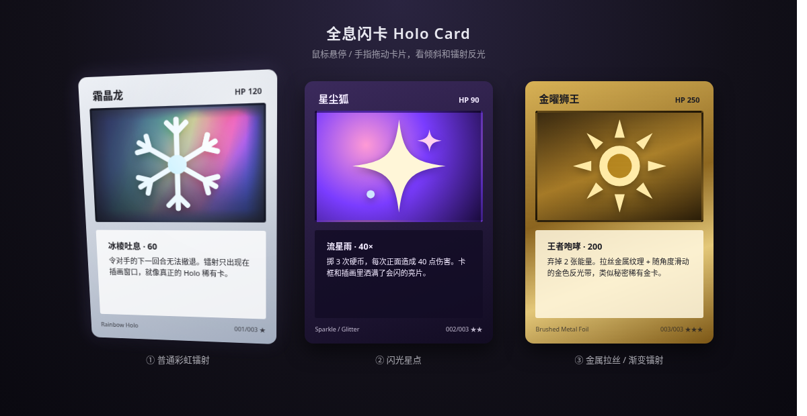

# Holo Card 全息闪卡

零依赖的网页全息闪卡特效：鼠标悬停或手指拖动时卡片 3D 倾斜，高光与镭射随指针流动，移开后平滑回正。

**在线预览：** https://mattamior.github.io/holo-card/

## 三种效果
1. **彩虹镭射**：彩虹条纹 + 扫描线，只出现在插画窗口，四边羽化。
2. **闪光星点**：柔边亮片与四芒星，只在指针附近闪烁。
3. **金属拉丝**：纯 CSS 拉丝纹理 + 随指针滑动的金色反光带。

## 原理
指针位置经弹簧缓动后写入 CSS 变量，CSS 用这些变量驱动 `rotateX/Y` 倾斜、`radial-gradient` 高光，以及 `repeating-linear-gradient` + `color-dodge` 混合的镭射层。支持触摸（Pointer Events），并尊重 `prefers-reduced-motion`。

## 使用
直接用浏览器打开 `index.html` 即可。尺寸、透视、色板、光泽强度等都是文件开头的 CSS 变量；倾斜角度与弹簧手感在脚本的 `CONFIG` 里调整。

## 致谢
思路参考 [simeydotme/pokemon-cards-css](https://github.com/simeydotme/pokemon-cards-css)。卡面均为 CSS 与内联 SVG 绘制，无外部图片素材。
