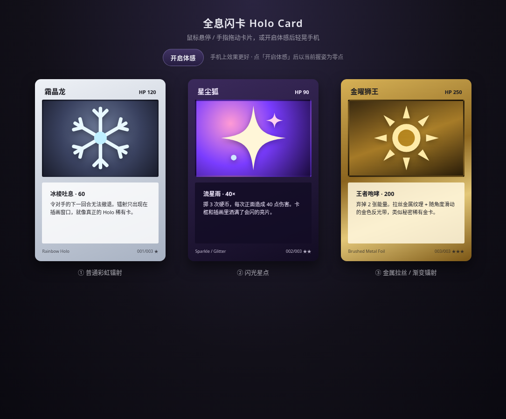

# Holo Card 全息闪卡

零依赖的网页全息闪卡特效：鼠标悬停或手指拖动时卡片 3D 倾斜，高光与镭射随指针流动，移开后平滑回正。`feature/gyro` 分支额外支持手机陀螺仪体感倾斜。

**在线预览（main / GitHub Pages）：** https://mattamior.github.io/holo-card/

> GitHub Pages 目前只发布 **main**。要预览本分支的体感功能，请：
> - 克隆后 `git checkout feature/gyro`，用手机浏览器打开本地 `index.html`（需 HTTPS 或 localhost），或
> - 在仓库页切换到 `feature/gyro` 查看源码。

## 分支

| 分支 | 内容 |
|------|------|
| `main` | CSS 全息闪卡基线（指针 / 触摸） |
| `feature/gyro` | 在基线上增加 DeviceOrientation 体感倾斜 |

## 三种效果
1. **彩虹镭射**：彩虹条纹 + 扫描线，只出现在插画窗口，四边羽化。
2. **闪光星点**：柔边亮片与四芒星，只在指针附近闪烁。
3. **金属拉丝**：纯 CSS 拉丝纹理 + 随指针滑动的金色反光带。

## 体感倾斜（本分支）
1. 用手机打开页面（HTTPS 或本机 localhost）。
2. 点 **「开启体感」**。
3. **iOS Safari**：系统会弹出「运动与方向」权限，选允许；必须由你点击按钮触发，页面不能静默开启。
4. 开启瞬间以当前握姿为零点，之后相对晃动才会倾斜；再点一次按钮可关闭。
5. 鼠标 / 手指与陀螺仪可并存：正在拖卡片时以指针为准，松手稍后体感会接上。
6. 若系统开启了「减少动态效果」，体感不会启用。
7. 嵌在 iframe 里时，父页面需设置 `allow="accelerometer; gyroscope"`。

桌面浏览器也可以点按钮走一遍权限流程，但没有真实传感器时几乎看不到晃动，**手机上效果更好**。

## 原理
指针或陀螺仪算出的姿态经低通 + 弹簧缓动后写入 CSS 变量，CSS 用这些变量驱动 `rotateX/Y` 倾斜、`radial-gradient` 高光，以及 `repeating-linear-gradient` + `color-dodge` 混合的镭射层。支持触摸（Pointer Events），并尊重 `prefers-reduced-motion`。

## 使用
直接用浏览器打开 `index.html` 即可。尺寸、透视、色板、光泽强度等都是文件开头的 CSS 变量；倾斜角度、弹簧手感与陀螺仪量程在脚本的 `CONFIG` 里调整。

## 致谢
思路参考 [simeydotme/pokemon-cards-css](https://github.com/simeydotme/pokemon-cards-css)。卡面均为 CSS 与内联 SVG 绘制，无外部图片素材。
