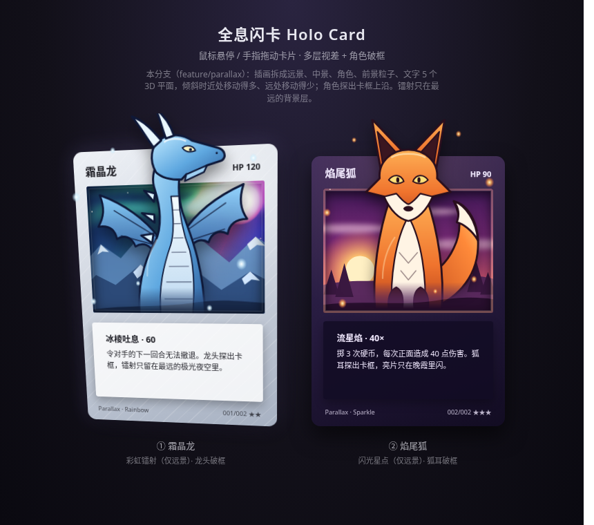

# Holo Card 全息闪卡

零依赖的网页全息闪卡特效：鼠标悬停或手指拖动时卡片 3D 倾斜，高光与镭射随指针流动，移开后平滑回正。

**在线预览：** https://mattamior.github.io/holo-card/

> **当前分支：`feature/parallax`** —— 多层视差的角色破框立体卡（基于 main 的版本扩展，陀螺仪 / 局部箔面在其他分支）。

## 三种效果
1. **彩虹镭射**：彩虹条纹 + 扫描线，只出现在插画窗口，四边羽化。
2. **闪光星点**：柔边亮片与四芒星，只在指针附近闪烁。
3. **金属拉丝**：纯 CSS 拉丝纹理 + 随指针滑动的金色反光带。

## feature/parallax：多层视差 + 角色破框
两张卡：① 霜晶龙（彩虹镭射，龙头探出卡框）② 焰尾狐（闪光星点，狐耳探出卡框）。素材全部是内联 SVG / CSS 手绘，无外链图片。

**分层（由远到近）**
| 层 | 类名 | 深度 | 内容 |
|---|---|---|---|
| 远景 | `.win__bg` | 等效 z=-90 | 夜空 / 晚霞 + **箔光（只在这一层）** |
| 中景 | `.win__mid` | 等效 z=-40 | 冰川山脉 / 山丘松林 |
| 卡框 | `.layer--frame` | z=0 | 卡面底色 + 插画窗口 `.win`（`overflow:hidden` 裁剪远景/中景）+ 高光 |
| 文字 | `.layer--text` | z=16 | 名称、HP、技能面板 |
| 角色 | `.layer--char` | z=44 | 角色，向上超出窗口与卡片上沿（破框），底部柔和渐隐 |
| 前景 | `.layer--fg` | z=80 | 雪花 / 火星粒子，可飘出卡外 |

**做法要点**
- `.card` 提供 `perspective`，`.card__rotator` 设 `transform-style: preserve-3d` 并整体旋转；文字、角色、粒子是它的直接子元素，各自 `translateZ`，倾斜时近处层位移大、远处层位移小，形成景深。每层再乘 `scale(1 - z/透视)` 抵消近大远小，静止时与设计稿一致。
- **压平陷阱**：`overflow`、`opacity<1`、`filter`、`mask`、`mix-blend-mode`、`isolation` 出现在旋转容器上会把整个 3D 压成一张图。所以这些属性只放在各层自己身上或层内部（只压平该层自己的子树），箔光的 `color-dodge` 混合放在远景层内部完成。
- **窗口内为什么不用真 translateZ**：`overflow:hidden` 的窗口会压平内部 3D；若把远景做成卡后独立平面，倾斜时会从卡片侧边露出来。所以窗口内的远景/中景用 `translate(z·sin(倾斜角))` 位移——这正是该深度平面旋转后相对卡面的位移量，视觉等价于 translateZ，并且被窗口干净裁剪（需要 CSS `sin()`：Chrome 111+ / Firefox 108+ / Safari 15.4+；旧浏览器只是远景不动）。
- **破框热区**：角色探出卡框的部分在 `.card` 盒子外，而各层都是 `pointer-events:none`。`.card::after` 是一个透明伪元素，把指针热区向上扩展到角色层的外层包围盒（另留 8px 余量），所以鼠标只停在龙头或狐耳上也会倾斜；倾斜位置仍按卡片本体计算并限幅（指针在卡片上沿以上时按上沿算）。
- 前景粒子避开名称 / HP 标题栏，窄屏手机上也不会压到文字。
- 所有光层用多段渐变缓降，出血量 `--bleed` 大于最大位移，倾斜到极限也看不到层边缘或硬直线。

**可调参数**（`:root` 开头）
- `--z-bg` `--z-mid` `--z-text` `--z-char` `--z-fg`：各层深度；`--depth`：总深度倍率（0 = 扁平）
- `--breakout`：角色探出窗口上沿的高度（占卡高比例）；`--char-fade`：角色底部渐隐长度
- `--win-l/-t/-w/-h`：插画窗口位置；`--bleed`：远景/中景出血（须 ≥ |z-bg|×sin(最大倾斜角)×depth）
- `--persp`：透视距离；倾斜角度与弹簧手感仍在脚本 `CONFIG` 里

**自查截图**：`screenshots/parallax-idle.png`、`parallax-hover.png`，以及 Chromium / Firefox / WebKit 三内核的静止 + 左上 + 右上悬停对比：`parallax-chromium.png`、`parallax-firefox.png`、`parallax-webkit.png`。破框热区悬停：`parallax-breakout-hover.png`；窄屏（320 / 360 / 390px）标题栏：`parallax-mobile-header.png`。

## 原理
指针位置经弹簧缓动后写入 CSS 变量，CSS 用这些变量驱动 `rotateX/Y` 倾斜、`radial-gradient` 高光，以及 `repeating-linear-gradient` + `color-dodge` 混合的镭射层。支持触摸（Pointer Events），并尊重 `prefers-reduced-motion`。

## 使用
直接用浏览器打开 `index.html` 即可。尺寸、透视、色板、光泽强度等都是文件开头的 CSS 变量；倾斜角度与弹簧手感在脚本的 `CONFIG` 里调整。

## 致谢
思路参考 [simeydotme/pokemon-cards-css](https://github.com/simeydotme/pokemon-cards-css)。卡面均为 CSS 与内联 SVG 绘制，无外部图片素材。
